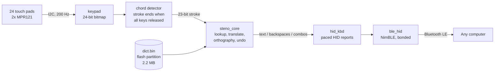

# Steno Keyboard

A stenography keyboard that does the steno translation by itself. Two touch pads, an ESP32, and about 3,900 lines of C. The PC doesn't need Plover or any driver: it just sees a normal Bluetooth keyboard.

[](../../actions/workflows/host-tests.yml)


<!-- photo goes here: docs/images/keyboard.jpg -->


---

## What it does

Steno lets you write a whole word with one chord (several keys pressed together), and people reach 200+ words per minute with it. The usual tool for this is [Plover](https://www.openstenoproject.org/plover/), but Plover has to be installed on the computer you type on. That rules out school computers, locked-down work PCs and phones.

So I moved the whole thing into the keyboard:

- 24 capacitive touch pads (two MPR121 chips, one per hand) are read 200 times a second.
- A chord counts as one stroke, and the stroke ends when every pad is released, like Plover.
- The ESP32 looks the stroke up in a Plover dictionary stored in its own flash, applies the spelling rules, and types the result over Bluetooth LE HID.

The computer only receives normal keystrokes, so it behaves like any Bluetooth keyboard. I've only tried it on Windows so far.

## Demo


You can try the engine on your PC without any hardware (needs `gcc` and Python 3):

```console
$ python3 tools/hosttest/demo.py TH- KWEUBG PWROUPB TPOBGS
this quick brown fox

$ python3 tools/hosttest/demo.py TKOG -G         # dog + suffix key, orthography kicks in
dogging

$ python3 tools/hosttest/demo.py KAT TKOG '*'    # * undoes the last stroke
cat
```

Run it with no arguments to type strokes one per line.

## Features

- Plover-compatible engine running on the ESP32: lookup, translation, formatting, undo
- Plover's `main.json` dictionary (147,424 entries) packed into 2.2 MB and read straight from flash, nothing copied into RAM
- Orthography, so `dog` + `-G` gives `dogging`
- Fingerspelling, numbers, capitalisation, punctuation
- Retro commands (toggle asterisk, delete space, insert space, repeat last stroke)
- Keyboard shortcuts as strokes: copy, paste, cut, select all, undo, arrows, Alt+Tab and so on. Your own go in `tools/user.json`
- BLE HID keyboard with bonding: pair once, it reconnects by itself
- Suspend and resume steno (`PHRO*F` / `PHRO*PB`) so you can type normally
- All the settings (pins, key map, sensor tuning, typing speed, Bluetooth name) are in `main/config.h`

## How it works



| Component | What it does |
|---|---|
| `components/mpr121` | I2C driver for the MPR121 touch chip, with tunable thresholds and filters |
| `components/keypad` | Reads both chips and merges them into one 24-bit bitmap |
| `components/steno_app` | Chord detector, plus the task that feeds the engine and maps the dictionary |
| `components/steno_core` | The steno engine. Plain C with no ESP-IDF in it, so it also builds on a PC |
| `components/hid_kbd` | Turns text, backspaces and key combos into HID reports at a safe pace |
| `components/ble_hid` | BLE HID keyboard on NimBLE (Just Works pairing, bonds saved in NVS) |
| `tools/convert_dict.py` | Builds `dict.bin` from Plover JSON dictionaries |

### Design decisions

**The engine doesn't know about the hardware.** `steno_core` only talks to the outside through callbacks (read some bytes, send some text). Because of that the same files run on the ESP32 and on a PC, which is how I could test it properly.

**Custom dictionary format.** Plover's `main.json` is about 4 MB of JSON, far too heavy to parse on an ESP32. `convert_dict.py` sorts the entries, front-codes them and compresses them with LZ4 in blocks of about 4 KB, with a small directory in front. A lookup is a binary search over the directory plus decompressing one block (a few blocks are cached). A 16-bit xor filter answers "is this a real word?" for the orthography rules, so the wordlist isn't stored as text.

**Dictionary stays in flash.** It has its own partition and is memory-mapped, so the ESP32's RAM is left for Bluetooth and the engine.

**Two I2C buses.** Both MPR121 boards use the same address (0x5A), so each one gets its own bus instead of fiddling with address jumpers. It also keeps the two hands independent.

**Paced typing.** A long word is a lot of HID reports. `hid_kbd` queues them and waits a few milliseconds between each, because the host can drop characters if they arrive too fast. The delay is one value in `config.h`.

## Testing

The engine is tested differently from the drivers, since it runs on a PC.

- `tools/hosttest/diff_test.py` feeds random stroke sequences (dictionary entries, meta commands, suffix keys, undo, retro commands) to both real Plover and this engine and compares the text.
- `tools/hosttest/smoke_test.py` checks 9 fixed behaviours without needing Plover. GitHub Actions runs it on every push, built with AddressSanitizer and UndefinedBehaviorSanitizer.

```bash
sh tools/hosttest/build.sh                  # build the engine for your PC
python3 tools/hosttest/smoke_test.py        # 9 checks

# against real Plover
pip install plover lz4
python3 tools/hosttest/diff_test.py tools/hosttest/hostt 1 300
```

The drivers (touch, Bluetooth) need the real board, so these tests don't cover them.

## Hardware

| Part | Notes |
|---|---|
| ESP32 dev board | original ESP32, 4 MB flash |
| 2x MPR121 breakout | 12-channel capacitive touch, I2C |
| 24 touch pads | two 4x3 grids, one per hand |
| Enclosure | 3D printed |

Power is over USB only. There's no battery yet.

| Signal | GPIO |
|---|---|
| Right hand MPR121, SDA / SCL (I2C0) | 27 / 26 |
| Left hand MPR121, SDA / SCL (I2C1) | 19 / 5 |

Pad layout:

```
 LEFT HAND                RIGHT HAND
 S  T  P  H               F  P  L  T
 S  K  W  R               R  B  G  S
 #  *  A  O               D  Z  E  U
```

Both `S` pads on the left give the same key. Pins and the pad map can be changed in `main/config.h`.

## Build and flash

You need [ESP-IDF](https://docs.espressif.com/projects/esp-idf/en/latest/esp32/get-started/). I built it with v6.1 and haven't tried other versions.

```bash
. $IDF_PATH/export.sh
idf.py set-target esp32
idf.py build flash monitor
```

`idf.py flash` writes `dict/dict.bin` to the `dict` partition as well.

**Changing the dictionary** (for example after editing `tools/user.json`):

```bash
pip install -r tools/requirements.txt
python tools/convert_dict.py        # priority: user.json > commands.json > main.json
idf.py flash
```

**Pairing:** power the board and add **Steno Keyboard** in your Bluetooth settings. No PIN. After the first time it reconnects on its own. The keyboard sends US key positions, so set the PC's input language to English (US) while using steno.

Flash layout (4 MB):

| Partition | Size | Content |
|---|---|---|
| `factory` | 1.25 MB | firmware |
| `dict` | 2.7 MB | `dict.bin` (2.2 MB used) |
| `nvs` | 24 KB | Bluetooth bonds |

## Troubleshooting

- **Phantom touches or stuck keys.** Don't touch the pads while the board boots, the MPR121 learns its baseline at start-up. Unused electrodes should be masked off in `CFG_PADx_ELECTRODE_MASK`.
- **I2C errors.** Some MPR121 boards have weak or no pull-ups. The internal ones are on by default; if it still fails, add 4.7k resistors from SDA and SCL to 3V3 on each bus.
- **Too sensitive or not sensitive enough.** Change `CFG_MPR_TOUCH_THRESHOLD` / `CFG_MPR_RELEASE_THRESHOLD` (12 / 6 to start). Set `CFG_TUNE_LOG_PERIOD_MS` to see the raw values in the serial log.
- **Missing or garbled letters.** Raise `CFG_HID_REPORT_INTERVAL_MS` (8 ms by default).
- **Won't reconnect after removing it in Windows.** The board accepts re-pairing by itself. If not, set `CFG_BLE_CLEAR_BONDS_ON_BOOT` to 1 for one boot.

## Limitations

- Not supported: prefix strokes, `{=conditional}`, `{MODE:...}`, user macros. Plover's default dictionaries don't need them.
- ASCII only. A US keyboard can't type anything else, so four dictionary entries are dropped and a few symbols (like `™`) turn into ASCII (`(TM)`).
- The dictionary can only be changed by re-flashing.
- Bluetooth only, no USB HID yet. USB powered only, no battery.
- Only tested on Windows.

## Roadmap

- [ ] Prefix strokes and conditional entries
- [ ] USB HID mode next to Bluetooth
- [ ] Update the dictionary over Bluetooth
- [ ] Battery

## Project layout

```
main/                 app entry point and config.h
components/
  mpr121/  keypad/    touch sensing
  steno_app/          chord detector and engine task
  steno_core/         steno engine (also builds on a PC)
  hid_kbd/  ble_hid/  keyboard output over Bluetooth LE
dict/dict.bin         prebuilt dictionary
tools/                dictionary converter, PC test tools, Plover files
```

## License and credits

GPL-2.0-or-later, see [LICENSE](LICENSE).

The dictionary (`tools/assets/main.json`, `commands.json`), the English wordlist, the orthography rules and the translation logic come from, or are ported from, [Plover](https://github.com/openstenoproject/plover) (GPL-2.0-or-later). That's why this project uses the same license. Thanks to the Open Steno Project.
